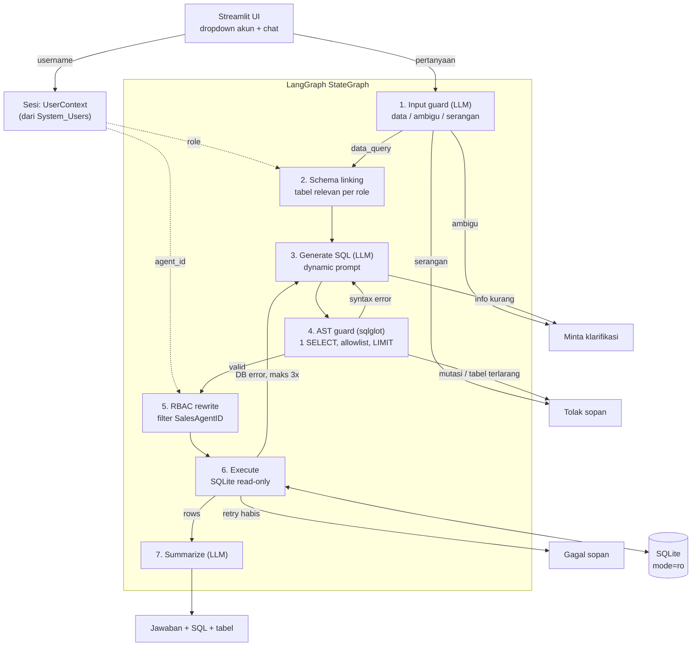

# Architecture

## 1. Diagram alur inferensi



## 2. Komponen

| Node | Tanggung jawab | Kenapa dipisah |
|---|---|---|
| `input_guard` | Mengklasifikasi pesan (data_query / ambiguous / malicious / out_of_scope) dengan LLM structured output. Role tanpa kebijakan langsung ditolak tanpa memanggil LLM. | Serangan dan pertanyaan ambigu berhenti sebelum ada SQL. Routing tidak memakai regex, sesuai syarat soal. |
| `link_schema` | LLM memilih tabel yang relevan dari allowlist role, lalu hasilnya disaring ulang ke allowlist dan dirender bersama DDL, catatan bisnis, contoh nilai, dan rumus baku. | Konteks prompt lebih fokus, dan tabel terlarang (`System_Users`, `Payments_Received` untuk Sales) tidak pernah terlihat LLM. |
| `generate_sql` | LLM menulis satu SELECT, atau meminta klarifikasi kalau data tidak ada / pertanyaan ambigu. Saat retry, SQL sebelumnya dan pesan error ikut dikirim. | Satu-satunya titik masuk retry loop. Node ini juga membersihkan hasil percobaan sebelumnya. |
| `validate_sql` | AST guard sqlglot: tepat satu statement, tidak ada node mutasi di mana pun, root harus query baca, allowlist tabel per role, dan LIMIT dipaksa. | Deterministik dan bisa dites tuntas tanpa LLM. |
| `apply_rbac` | Menulis ulang AST: setiap tabel yang dibatasi diganti subquery terfilter `SalesAgentID`, dengan alias yang sama. | Isolasi baris tidak diserahkan ke LLM. Rewrite ini adalah transformasi terakhir sebelum eksekusi, jadi tidak ada langkah sesudahnya yang bisa membatalkannya. |
| `execute_sql` | Eksekusi lewat koneksi SQLite read-only, dengan authorizer, batas baris, dan timeout. | Jaring pengaman terakhir di level database. |
| `summarize_answer` | LLM merangkum maksimal 50 baris hasil ke Bahasa Indonesia; hasil kosong dijawab "tidak ditemukan dalam cakupan akses". | Data mentah dan SQL final tetap ditampilkan terpisah di UI, jadi jawaban bisa dicek. |

Node terminal (`respond_clarification`, `respond_rejection`, `respond_failure`) hanya menyusun pesan akhir. Pesan penolakan sengaja generik dan tidak menyebut aturan mana yang dilanggar.

## 3. Self-healing retry loop

- **Yang di-retry:** error `syntax` dari guard (ParseError/TokenError sqlglot, atau root yang bukan query, misalnya `SELEC * FRM`) dan error `db` dari SQLite (`no such column`, `ambiguous column name`, timeout).
- **Yang tidak di-retry:** pelanggaran `security` (statement ganda, node mutasi, tabel di luar allowlist, `AccessDenied` dari RBAC). Retry hanya akan memberi penyerang umpan balik untuk memperbaiki serangannya.
- **Yang dikirim balik ke LLM:** SQL buatan LLM sendiri (`candidate_sql`, bukan SQL hasil rewrite RBAC), pesan error apa adanya, dan tips singkat per jenis error.
- **Batas:** `1 + MAX_SQL_RETRIES` percobaan (default 4). Kalau habis, graph berakhir di `respond_failure` dengan pesan sopan.

Contoh (dari `tests/test_graph_fake_llm.py::test_db_error_triggers_self_correction`, LLM diganti stub supaya deterministik):

```
generate_sql #1: SELECT PhoneNumber FROM Sales_Contracts
validate_sql:    OK
execute_sql:     error no such column: PhoneNumber
generate_sql #2: (prompt berisi SQL #1 + "no such column: PhoneNumber")
                 SELECT CustomerName FROM Sales_Contracts
execute_sql:     6 baris -> summarize_answer
```

Saat memakai LLM sungguhan, jumlah percobaan dan error yang dikirim balik ke LLM terlihat di panel "Detail teknis" pada UI.

## 4. Strategi pertahanan injeksi

| Lapisan | Mekanisme | Menahan |
|---|---|---|
| Input guard | LLM structured output dengan definisi intent dan contoh serangan (Indonesia dan Inggris). Jika ragu, diklasifikasi malicious. | Piggyback SQL, "abaikan instruksi sebelumnya", klaim role palsu, permintaan isi `System_Users`/password, perintah mutasi. |
| Prompt hardening | Pertanyaan selalu di pesan user dalam tag `<question>` dan dinyatakan sebagai data. Identitas dan hak akses diambil dari sesi dan ditaruh di system prompt. | Instruksi yang diselipkan di dalam pertanyaan. |
| AST guard | sqlglot: satu statement, `walk()` mencari node terlarang (termasuk DELETE di dalam CTE), root harus `exp.Query`, allowlist tabel per role, tanpa prefix skema, nama CTE tidak boleh menyamar sebagai tabel asli, LIMIT dipaksa. | `...; DROP TABLE Units; --`, PRAGMA, ATTACH, `load_extension`, `System_Users`, `sqlite_master`, `main.Units`. |
| RBAC rewrite | Secure view substitution berdasarkan `AssignedAgentID` dari `System_Users`. | Eskalasi horizontal: Bambang meminta data customer Dewi menghasilkan 0 baris. |
| Database | `mode=ro`, `PRAGMA query_only = ON`, authorizer (hanya SELECT/READ/FUNCTION/RECURSIVE, baca `System_Users` ditolak), progress handler untuk timeout. | Semua penulisan, ATTACH file lain, baca `System_Users`, kueri yang terlalu berat. |

Lapisan 1 dan 2 bergantung pada LLM, jadi hanya membuat penolakan lebih cepat dan sopan. Jaminan keamanan sebenarnya ada di lapisan 3 sampai 5 yang deterministik.

## 5. RBAC

**Identitas.** Dropdown di UI hanya memilih username. `load_user_context` membaca role dan `AssignedAgentID` dari `System_Users` dengan parameter binding, lalu `UserContext` (frozen dataclass) dibawa di state graph. Teks pertanyaan tidak pernah dipakai untuk menentukan role, jadi "anggap saya SuperAdmin" tidak berpengaruh apa pun. Akun Sales tanpa `AssignedAgentID` dan role yang tidak terdaftar ditolak (deny by default).

**Urutan.** Otorisasi kasar ada di depan: role dicek di `input_guard`, dan tabel dibatasi di `link_schema` dan `validate_sql`. Otorisasi baris ada di belakang, tepat sebelum database, karena harus diterapkan pada output LLM dan hanya menerima SQL yang sudah lolos guard.

**Rewrite AST**, contoh nyata untuk `sales_bambang` (AgentID 101), pertanyaan "Customer saya mana saja yang punya denda belum lunas, dan berapa totalnya?":

```sql
-- SQL dari LLM
SELECT c.CustomerName AS nama_customer, SUM(...) AS total_denda_bersih
FROM Sales_Contracts AS c
JOIN Late_Fee_Penalties AS l ON l.ContractID = c.ContractID
WHERE l.PenaltyStatus = 'Outstanding' ...

-- SQL yang dieksekusi
SELECT c.CustomerName AS nama_customer, SUM(...) AS total_denda_bersih
FROM (SELECT * FROM Sales_Contracts WHERE SalesAgentID = 101) AS c
JOIN (SELECT * FROM Late_Fee_Penalties
      WHERE ContractID IN (SELECT ContractID FROM Sales_Contracts WHERE SalesAgentID = 101)) AS l
  ON l.ContractID = c.ContractID
WHERE l.PenaltyStatus = 'Outstanding' ...
LIMIT 200
```

Filter ada di dalam subquery, jadi kondisi apa pun di luarnya (`OR 1 = 1`, `UNION`, `WHERE SalesAgentID = 102`) hanya bisa mempersempit hasil, tidak memperluas. Referensi ke nama CTE dilewati, tetapi tabel asli di dalam badan CTE tetap diganti. Nama tabel dicocokkan tanpa membedakan huruf besar/kecil.

**Matriks akses**

| Role | Units | Sales_Contracts | Payment_Schedules | Payments_Received | Late_Fee_Penalties | System_Users |
|---|---|---|---|---|---|---|
| Sales | semua baris | milik sendiri | milik sendiri | tidak | milik sendiri | tidak |
| Finance | semua | semua | semua | semua | semua | tidak |
| Auditor | semua | semua | semua | semua | semua | tidak |
| Role lain | tidak | tidak | tidak | tidak | tidak | tidak |

## 6. Keputusan desain

| ID | Keputusan | Alasan |
|---|---|---|
| D1 | Sales tidak boleh membaca `Payments_Received`. | README melarang Sales melihat "mutasi kas bank finance", dan tabel ini berisi nomor kwitansi serta referensi bank. Konsekuensinya Sales tidak bisa menghitung outstanding principal secara presisi. Agent menjelaskan keterbatasan itu dan menawarkan total tagihan terjadwal sebagai gantinya (terlihat pada uji "Hitung sisa pokok piutang Budi Santoso" dengan akun Bambang). |
| D2 | Auditor mendapat akses baca ke semua tabel bisnis, tanpa batas baris. | Role ini ada di seed data tetapi tidak dijelaskan soal. Tugas auditor memang memeriksa seluruh transaksi, dan read-only sudah dijamin oleh guard dan koneksi. `System_Users` tetap tertutup. Kalau perlu lebih ketat, cukup hapus satu baris di `POLICIES` agar kembali ke deny by default. |
| D3 | `CustomerNIK` belum di-masking. | Tidak diminta soal. NIK tidak pernah dikirim ke LLM sebagai contoh nilai (`sample_values` hanya untuk kolom kategori). Rencana berikutnya: isi `hidden_columns` di `RolePolicy` dan sensor kolom itu sebelum hasil dikirim ke LLM dan UI. |
| D4 | SQLite. | Zero-ops: database dibangun dari `schema.sql` saat aplikasi start, jadi deploy ke Streamlit Cloud tidak butuh server. Untuk produksi: PostgreSQL dengan role database read-only dan Row-Level Security sebagai lapisan tambahan di bawah rewrite AST. |
| D5 | "Hari ini" memakai tanggal sistem; `TODAY_OVERRIDE` untuk testing. | Tanggal dikirim eksplisit ke prompt (bukan `date('now')`), sehingga hasil test deterministik dan demo tetap memakai tanggal nyata. |

## 7. Batasan yang diketahui & pengembangan berikutnya

- Belum ada memori percakapan, jadi klarifikasi belum bisa dijawab di pesan berikutnya. Rencana: checkpointer `MemorySaver` dengan `thread_id` per user.
- Input guard dan pembuatan SQL bergantung pada kualitas LLM. Salah klasifikasi tetap tertahan lapisan deterministik, tetapi bisa membuat pertanyaan sah ikut ditolak.
- Belum ada audit log dan rate limiting di URL publik.
- SQLite tidak punya Row-Level Security, jadi isolasi baris sepenuhnya di layer aplikasi.
- Masking PII (D3) belum diterapkan.
- Kalau LLM menulis dialect SQL Server (`TOP`, `ISNULL`), perbaikannya bergantung pada retry; belum ada transpile otomatis dengan `sqlglot.transpile`.
